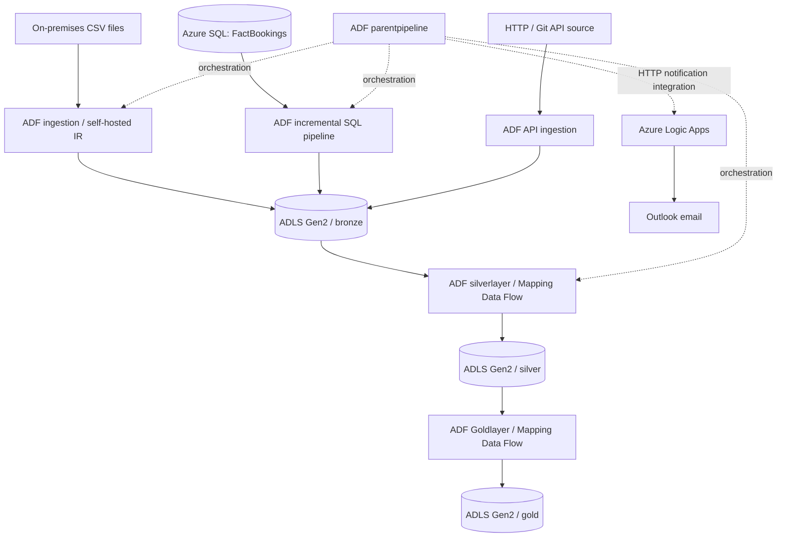

# ✈️ Flight Data Engineering | Azure Medallion Architecture

    

> **Production-oriented portfolio / hands-on learning project.** An end-to-end, multi-source flight-data ingestion and transformation solution built with Azure Data Factory (ADF), Azure Data Lake Storage Gen2, Azure SQL Database, and Azure Logic Apps. The project implements production-inspired patterns; it is not represented as a live enterprise production deployment.

## 📌 Project overview

The project integrates **flight, airline, passenger, and booking data** from on-premises CSV files, an Azure SQL database, and an HTTP/API source. Azure Data Factory orchestrates ingestion into the **Bronze** layer, transforms data for the **Silver** layer, and runs a **Gold**-layer data flow to produce business-oriented outputs. An Azure Logic App receives an HTTP request and sends an email notification, providing a foundation for operational alerts.

**Key implementation highlights**

- **7 ADF pipelines**, **16 datasets**, **2 mapping data flows**, and **4 linked services** visible in ADF Studio.
- Source-specific ingestion from **on-premises file system**, **Azure SQL**, and **HTTP/API**.
- ADF **Lookup + Copy** pattern for SQL incremental loading using last/latest load boundaries and a watermark activity.
- Separate **Bronze**, **Silver**, and **Gold** ADLS Gen2 containers.
- **Logic App HTTP trigger → Outlook email** workflow with a successful test run.
- GitHub-integrated ADF JSON definitions for version control and reproducibility.

## 🏗️ Architecture



*Architecture is a conceptual summary of the components demonstrated. The exact parent-pipeline activity dependencies and all Gold transformation expressions are not fully visible in the supplied screenshots; inspect the ADF JSON files for definitive behavior.*

## 🧰 Technology stack

| Service / tool | Role |
|---|---|
| **Azure Data Factory** | Ingestion, pipeline orchestration, incremental copy, mapping data flows |
| **Azure Data Lake Storage Gen2** | Bronze/Silver/Gold lake storage |
| **Azure SQL Database** | Structured flight-booking source and SQL queries |
| **Self-hosted Integration Runtime** | On-premises file connectivity (represented by the repository's integration runtime configuration) |
| **HTTP linked service / Web activity** | API ingestion |
| **Azure Logic Apps + Outlook connector** | HTTP-triggered email notifications |
| **GitHub** | ADF source control and project documentation |

### Azure resource overview

The resource group contains an Azure Data Factory, SQL server and database, storage account, Logic App, and API connection.


## 🥉 Bronze — multi-source ingestion

The storage account uses three **private** containers for the medallion layers (`bronze`, `silver`, `gold`) and also contains an Azure-managed `$logs` container.


**Bronze directory structure observed in Azure Portal:**

```text
bronze/
├── Gitapi/          # HTTP / Git API ingestion
├── Monitor/         # Monitoring-related landing area
├── onprem/          # On-premises CSV files
│   ├── DimAirline.csv
│   ├── DimFlight.csv
│   └── DimPassenger.csv
└── sql/             # Azure SQL landing area

silver/              # Transformed / prepared data

gold/                # Business-oriented curated layer
```


### On-premises flight dimensions

The screenshot confirms three CSV files landed in `bronze/onprem/`: `DimAirline.csv`, `DimFlight.csv`, and `DimPassenger.csv`. ADF includes `onprem_ingestion` and `test_onprem_ingestion` pipelines.


### SQL source: flight booking facts

The Azure SQL query editor shows a `dbo.FactBookings` table and sample rows.

| Column | Type |
|---|---|
| `booking_id` | `INT PRIMARY KEY` |
| `passenger_id` | `INT` |
| `flight_id` | `INT` |
| `airline_id` | `INT` |
| `origin_airport_id` | `INT` |
| `destination_airport_id` | `INT` |
| `booking_date` | `DATE` |
| `ticket_cost` | `DECIMAL(10,2)` |
| `flight_duration_mins` | `INT` |
| `checkin_status` | `VARCHAR(10)` |


### Incremental Azure SQL ingestion

The `azuresqlpipeline` screenshot shows this sequence:

1. **`Lastload`** Lookup obtains the previously recorded load boundary.
2. **`Latestload`** Lookup obtains the latest load boundary.
3. **`azuresqlactivity`** Copy Data activity runs after both lookups succeed.
4. **`Watermarkdata`** Copy Data activity runs after the SQL copy succeeds.

This is a **watermark-based incremental ingestion pattern**. The exact filter query, watermark persistence logic, and destination mapping should be verified from `pipeline/azuresqlpipeline.json` before treating them as implementation details.


### HTTP / API ingestion

The `git_ingestion` pipeline runs a **`WebApiGit`** Web activity followed by **`CopyGitData`** Copy Data on success, demonstrating API-oriented ingestion into the lake.


## 🥈 Silver — transformation

The `silverlayer` pipeline and the ADF mapping data flows represent the transformation stage. This stage prepares raw Bronze data for downstream use; the exact column-level operations (filters, derived columns, joins, etc.) should be read from the `dataflow/` JSON before being documented as confirmed.

## 🥇 Gold — curated / business-ready data

The `Goldlayer` pipeline contains an activated Mapping Data Flow activity named **`GoldlayerDataflow`**. The ADF tab bar also shows data flows named `DataTransformation` and `DimServing`. Gold is intended for curated analytical outputs; the screenshots do not yet establish specific Gold table schemas or metrics.


## ⚙️ ADF project inventory

### Pipelines (7)

| Pipeline | Purpose / evidence |
|---|---|
| `azuresqlpipeline` | Incremental Azure SQL copy with two lookups and watermark-related activity |
| `git_ingestion` | Web activity followed by API data copy |
| `Goldlayer` | Runs `GoldlayerDataflow` |
| `onprem_ingestion` | On-premises ingestion pipeline (internal activity graph not shown) |
| `parentpipeline` | Parent orchestration pipeline (internal activity graph not shown) |
| `silverlayer` | Silver transformation pipeline (internal activity graph not shown) |
| `test_onprem_ingestion` | On-premises ingestion test pipeline (internal activity graph not shown) |


### Linked services (4)

| Linked service | Connection type |
|---|---|
| `ls_azuredb` | Azure SQL Database |
| `ls_datalake` | Azure Data Lake Storage Gen2 |
| `ls_gitapi` | HTTP |
| `ls_onprem_file` | File system |


The ADF Studio panel also shows **16 datasets** and **2 mapping data flows**. Definitions are versioned in `dataset/` and `dataflow/` respectively.

## 📩 Logic Apps — notification workflow

The Logic App workflow contains:

```text
When an HTTP request is received (POST)
                 ↓
          Send an email (V2)
```

The visible HTTP request schema includes `pipeline_name`, `run_id`, and `status` fields. The screenshots show **a successful Logic App execution**, with both the trigger and email action marked successful. The sample email body contains a **Succeeded** pipeline status, so this demonstrates notification delivery, **not an independently verified failed-pipeline alert**. Failure-only conditions should be verified in the ADF `parentpipeline` before claiming end-to-end failure alerting.


**Suggested professional email subject:** `ADF Pipeline Alert | @{pipeline_name} | @{status}` (illustrative format; configure expressions according to the Logic App trigger schema).

## 📂 Repository structure

The ADF Git integration creates the following source-control structure (directory contents vary by actual definitions):

```text
ProductionReadyMedalian-Arch/
├── pipeline/                 # ADF pipeline definitions
├── dataset/                  # ADF dataset definitions
├── dataflow/                 # Mapping data flow definitions
├── linkedService/           # Connection metadata — REVIEW BEFORE PUBLISHING
├── integrationRuntime/      # Integration runtime definitions
├── factory/                 # Data Factory configuration
├── publish_config.json
├── screenshots/             # Sanitized architecture / implementation evidence
└── README.md                # This documentation
```

**Note:** The Azure Data Lake data itself is **not** automatically copied to GitHub when ADF source control is configured. Only include synthetic / non-sensitive samples if helpful.

## 🔐 Security & safe sharing

- **Never commit** storage account keys, SAS tokens, SQL passwords, API secrets, signed Logic App callback URLs, or Integration Runtime authentication keys.
- Review `linkedService/`, pipeline parameters, datasets, and **Git history** before making the repository public.
- Remove or anonymize personal email recipients, subscription identifiers, private hostnames/IP addresses, and sample records containing personal data.
- A screenshot showing `Authentication method: Access key` **does not reveal the key itself**; avoid opening or sharing the actual key.
- Use environment-specific settings and secure secret management for any redeployment.
- If a secret has already been committed, **rotate it**; deleting the current file does not remove historical exposure.

## 🚀 How to explore / reproduce

1. Review the ADF JSON definitions in `pipeline/`, `dataset/`, `dataflow/`, and `linkedService/`.
2. Provision an Azure SQL database, ADLS Gen2 storage account, and Azure Data Factory in your own subscription.
3. Configure Bronze, Silver, and Gold storage paths and required source datasets.
4. Configure the linked services using **your own credentials**, never credentials from this repository.
5. Configure a reachable self-hosted Integration Runtime for on-premises files, where required.
6. Deploy or import ADF definitions with the correct environment-specific parameters and permissions.
7. Set up an HTTP-triggered Logic App and a permitted email connection; configure ADF notification invocation and verify success/failure conditions.
8. Validate each ingestion pipeline, transformation flow, and downstream output separately.

*Running Azure resources can incur charges. The JSON files are implementation definitions, not a one-click fully configured deployment.*

## 🧪 Evidence and validation

- Azure Portal screenshots verify the resource inventory and ADLS containers.
- Bronze screenshots verify the landed on-premises dimension files.
- ADF screenshots verify the pipeline inventory and the shown SQL, API, and Gold activity chains.
- Logic App screenshots verify a successful HTTP-triggered email workflow.
- These screenshots **do not alone prove** full end-to-end pipeline execution, Gold data quality, or an actual failed-pipeline alert.

## 📚 Learning reference

Built as a hands-on project inspired by this [Azure Data Engineering tutorial](https://www.youtube.com/watch?v=Za_9XYwPbKM). The implementation and screenshots document the work represented in this repository.

---

**Portfolio focus:** Azure Data Engineering · ADF · ETL/ELT · Incremental Loading · Medallion Architecture · ADLS Gen2 · Azure SQL · Logic Apps · GitHub
